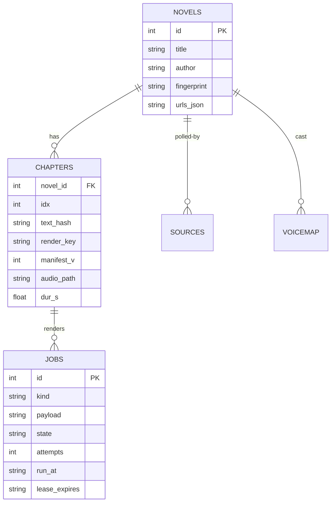
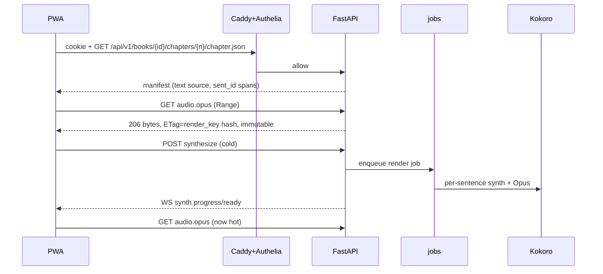

# InkCast Architecture (production-grade, single-user LAN)

> Source of truth for behavior: `review/10_locked_decisions.md` (20 locks).
> Build plan: `.omo/plans/inkcast.md`. This doc is the OSS-readable view.

## System overview

```mermaid
flowchart LR
  subgraph LAN[Browser LAN]
    PWA[OpenReader fork<br/>static PWA]
  end
  subgraph Edge[Caddy :80]
    C[Caddy<br/>reverse proxy]
    A[Authelia 4.39<br/>login wall]
  end
  subgraph App[Backend FastAPI]
    API[/api/v1]
    JJ[jobs table<br/>scheduler]
    R[render pipeline<br/>Kokoro + Opus]
    S[scraper exec<br/>lncrawl sidecar]
    B[backup ZIP<br/>age]
  end
  subgraph Side[lncrawl sidecar 4.14.0]
    LC[lightnovel-crawler<br/>sleep infinity]
  end
  PWA -->|cookie| C -->|forward-auth| A
  C -->|allow| API
  API --> JJ --> R
  API --> S -.docker exec.-> LC
  R -->|Opus + manifest| PWA
  B <-->|ZIP no audio| PWA
```

Why this shape: zero auth code in app (premade wall), single SQLite file
(portable backup), lncrawl as dumb fetcher behind our gate/scheduler
(no GPL vendoring, no weekly parser rot), Kokoro-only (no cloning).

## Data layout



- Audio bytes: `audio/{novel}/{shard}/{idx}.{hash8}.opus`, `shard = idx//1000`.
- Sidecar: `{idx}.{hash8}.json` v2, `sent_id` positional per chapter version,
  `render_key = voice+speed+model`, timings measured from shipped bytes,
  gapless invariant `next.t_start == prev.t_end`.
- `/data/db` host-local disk ONLY (WAL corrupts on NFS); audio/epubs/backups
  may live on NAS.

## Request flows



- Full-chapter re-synth on text change (no diff).
- Voice/speed/model change pins old `render_key`; new renders only + explicit
  re-render button (no library storm).

## Appendix — doc index (finale pass, existing diagrams above untouched)

- Data model + sidecar v2 + storage invariants: `docs/data/model.md`
- Render pipeline detail: `docs/flows/render.md`
- Crawl lifecycle + refetch: `docs/flows/crawl.md`
- Playback + progress holes: `docs/flows/playback.md`
- Backup ZIP + merge: `docs/flows/backup.md`
- Auth wall sequence: `docs/flows/auth.md` (operator notes: `docs/ops/auth-wall.md`)
- OPDS catalog + M4B export: `docs/flows/opds-m4b.md`
- Deployment (services/volumes/boot): `docs/flows/deployment.md`
- Frozen route table: `docs/API.md` (source: `openapi.yaml`)
- Every env var: `docs/ops/CONFIG.md`
- Hardening gates with commands: `docs/ops/HARDENING.md`
- Boot proof: `ops/BOOT_CHECK.md` (README quickstart matches its commands)
- Voice shortlist procedure: `ops/ABX.md`
