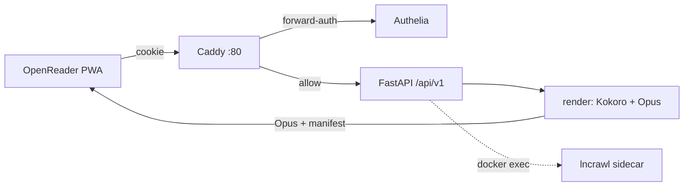

# InkCast

Self-hosted light-novel + Kokoro TTS platform for one household on its own LAN.
Point lncrawl at a novel, InkCast renders every chapter to immutable Opus audio
with sentence-exact sidecars, and an OpenReader PWA fork reads along with
word-level highlight. No accounts server, no cloud, no GPU: FastAPI + SQLite +
lncrawl sidecar behind an Authelia/Caddy login wall, sync via encrypted backup
ZIP.

**Why this shape (the 20 locks, condensed):** zero auth code in app (premade
wall); single SQLite file (portable backup ZIP, no PG until measured
contention); lncrawl as dumb fetcher behind our content gate/scheduler (no
weekly parser rot, no GPL vendoring); Kokoro-82M ONNX CPU only (no cloning, no
GPU); timings measured from shipped Opus bytes (Opus padding shifts estimates);
full-chapter re-synth, never diff (positional `sent_id` + diff-merge corrupted
more than it saved); `render_key` pinned per chapter (a voice change must never
storm the library). Full rationale: `.omo/plans/inkcast.md`, `ARCHITECTURE.md`.



## Features (v1)

- **Crawl:** lncrawl 4.14.0 sidecar via `docker exec`, validate-then-commit
  content gate, error classes (blocked/empty/parse/transient), source
  quarantine, per-chapter / per-novel / per-source refetch.
  ([crawl flow](docs/flows/crawl.md))
- **Render:** Kokoro-82M ONNX CPU, regex pron-dict pre-replace, sentence
  splitter (abbrev safelist + CJK), per-sentence PCM -> Opus 32k mono 24kHz,
  gapless manifest (`next.t_start == prev.t_end`).
  ([render flow](docs/flows/render.md))
- **Read-along:** static OpenReader fork, manifest binary-search highlight
  <200ms, tap-to-seek, tab leader, `pagehide` snapshot, offline error state.
  ([playback](docs/flows/playback.md))
- **OPDS 1.2 + M4B:** token-exempt catalog/search for KOReader, per-book M4B
  (AAC-LC 64k mono, ffmetadata chapters, +43ms priming shift).
  ([opds-m4b](docs/flows/opds-m4b.md))
- **Backup sync:** age-encrypted ZIP (DB + sidecars + covers, no audio),
  staging LWW merge, double-import idempotent, restore drill.
  ([backup](docs/flows/backup.md))
- **Voice suite:** 6-voice ABX shortlist (`ops/ABX.md`), per-character
  voice-map, pron-dict union merge.
- **Hardening gates:** Range 206 curl, RTF p50<=0.7, solver check, restore
  drill, ABX build — exact commands in
  ([HARDENING](docs/ops/HARDENING.md)).

## Quickstart

Needs: Docker + Compose, `.env` filled (see below). From repo root:

```bash
docker compose config > /tmp/inkcast-config.yml && echo CONFIG_OK
docker compose up -d --build
docker compose ps
curl -s http://127.0.0.1:8000/api/v1/health
```

Same commands as `ops/BOOT_CHECK.md` (the wall checks live there). Then:

1. Copy `.env.example` -> `.env`, fill `API_TOKEN` + three `AUTHELIA_*`
   secrets (all required — backend fail-closes without `API_TOKEN`).
2. Hash a password into `ops/users_database.yml`:
   `docker run --rm authelia/authelia:4.39 authelia crypto hash generate argon2 --password 'YOUR_PASSWORD'`
3. Open `http://<host-lan-ip>/` in a browser, log in via Authelia
   (30-day session). API at `http://<host-lan-ip>/api/v1/books`.
4. Mint a per-device OPDS token for KOReader (no login possible there):
   see `ops/BOOT_CHECK.md` step 4, full flow in
   [opds-m4b](docs/flows/opds-m4b.md).

Config reference: every variable in [docs/ops/CONFIG.md](docs/ops/CONFIG.md).

## Backup sync (phone <-> server, no accounts)

```bash
# export (API_TOKEN required) -> age-encrypted ZIP, audio excluded
curl -X POST -H "Authorization: Bearer $API_TOKEN" \
  http://127.0.0.1/api/v1/admin/backup -o inkcast-backup.zip
```

Import on the second device through the UI or API; merge is field-level LWW
in staging, voice-map per-character-key, pron-dict record union, progress
clamped on `text_hash` change with orphan flag. Re-importing the same file is
a no-op. Full rules: [backup flow](docs/flows/backup.md).

## OPDS + KOReader

1. Mint token (BOOT_CHECK step 4).
2. In KOReader: add catalog
   `http://<host-lan-ip>/api/v1/opds/catalog.xml?token=<TOKEN>`.
3. Search works at `/api/v1/opds/search?q=...&token=<TOKEN>`; per-book
   audiobook at `/api/v1/opds/books/<id>.m4b?token=<TOKEN>`.

## Voice ABX (pick the narrator by ear)

Build the 6 clips with the command in `docs/ops/HARDENING.md` gate 5,
shuffle blind, score clarity/fatigue/fit/consistency per `ops/ABX.md`, record
the winner as default voice (`PUT /api/v1/voices`). Never ABX on stub-tone
output (voice-identical without the model).

## Hardening gates (prove it, don't claim it)

| Gate | Command | Evidence |
|------|---------|----------|
| Range 206 + If-Range | curl `-H 'Range: bytes=0-99'` | `206` + `Content-Range` |
| RTF p50 <= 0.7 | bench snippet | bench stdout |
| Solver check | `docker exec inkcast-lncrawl crawl --help` + classify asserts | quarantine jobs row |
| Restore drill | export/import round-trip | `IMPORT_2_IDEMPOTENT_OK` |
| 6-voice ABX | render 6 clips | `/tmp/abx/*.opus` + score sheet |

All five: exact commands in [HARDENING](docs/ops/HARDENING.md);
fast proof `python3 -m pytest backend/tests/test_hardening.py -q`.

## Repo map

```
backend/app/        FastAPI: main, db, models, render, tts, gate, jobs,
                    scraper/, scheduler, refetch, playback, progress,
                    opds, m4b, backup, merge, auth, pron
backend/alembic/    migrations (upgrade head idempotent)
frontend/           OpenReader fork (static build served from /app/frontend/dist)
ops/                Caddyfile, authelia-config.yml, BOOT_CHECK.md, ABX.md
docs/flows/         crawl, render, playback, backup, auth, opds-m4b, deployment
docs/ops/           auth-wall, HARDENING, CONFIG
docs/data/model.md  ER + field rules + sidecar v2 schema + storage invariants
docs/API.md         frozen route table (mirrors openapi.yaml)
openapi.yaml        route table source of truth — path changes break UI+OPDS
docker-compose.yml  caddy + authelia + backend + lncrawl (+ tailscale profile)
```

Full data model: [docs/data/model.md](docs/data/model.md).
API table: [docs/API.md](docs/API.md).
Deployment: [docs/flows/deployment.md](docs/flows/deployment.md).

## Contributing / License

Build order is Waves (foundation first, then parallel, then integration) with
per-task gates — see [CONTRIBUTING.md](CONTRIBUTING.md). License: MIT
([LICENSE](LICENSE)).
