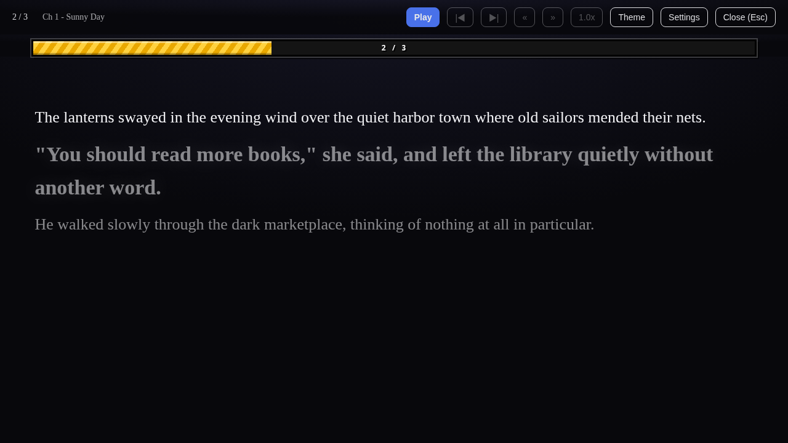
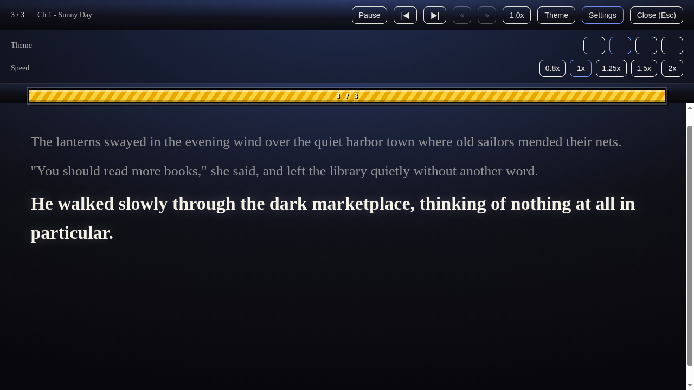
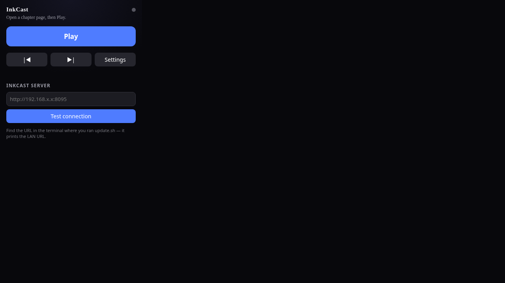
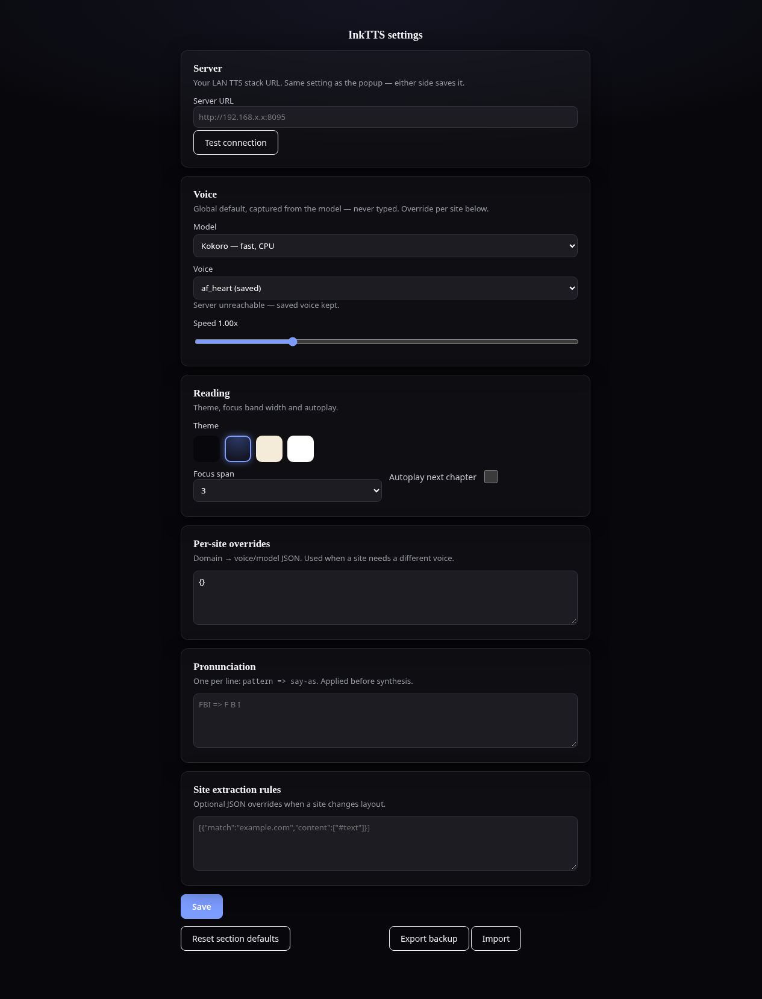
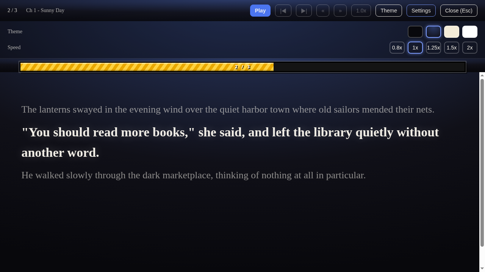
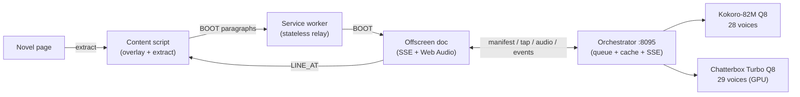

# InkTTS — LAN Novel Read-Along

[](LICENSE)
[]()
[]()
[]()
[]()

> Read light novels on their websites, narrated by local AI voices with a
> read-along highlight that follows the audio. One Docker stack on your LAN
> renders the audio; a Chrome extension turns any chapter page into a
> focused, immersive reader.

Topics: `text-to-speech` · `tts` · `kokoro` · `chatterbox` · `gguf` · `read-along` · `chrome-extension` · `novel-reader` · `lan-server` · `vulkan`




| Popup transport | All settings |
|---|---|
|  |  |



## Features

- **28 Kokoro voices + 29 Chatterbox voices** — captured live from the models, picked from a dropdown (never typed). Chatterbox ships 28 premade MIT-licensed reference voices.
- **Immersive-only reader** — full-takeover overlay, lit-band focus that dims the rest, chapter title header, prev/next chapter buttons, pixel health-bar chapter progress.
- **Real playback** — gapless Web Audio chaining, tap any line to seek, pause resumes the exact sentence, speed 0.8–2.5×, autoplay across chapters.
- **Reliable extraction** — layered title/chapter-link finder (site rules → `rel=` semantics → scored scan → validated-or-nothing), bot-check and image-only pages fail loud, never narrated.
- **Private by design** — everything runs on your LAN. No accounts, no cloud, no telemetry. GGUF weights, no 20 GB torch stacks.

## Quick start

Prereqs: Docker Engine on an x86_64 Linux host. GPU is optional (AMD/NVIDIA via
Vulkan); without one, Chatterbox stays idle and Kokoro renders on CPU.

```bash
cd tts-stack
docker compose up -d --build        # pulls engines, downloads ~1.3 GB of GGUFs once
./update.sh                         # rebuilds, then prints your LAN URL, e.g. http://192.168.29.101:8095
```

Load the extension:

1. `chrome://extensions` → Developer mode → **Load unpacked** → `extension/.output/chrome-mv3` (run `pnpm install && pnpm build` in `extension/` first — needs Node 20+).
2. Click the InkTTS icon → paste your LAN URL → **Test connection**.
3. Open any novel chapter → **Play chapter**.

That's it. First Play on a chapter takes ~10 s (rendering); after that the highlight follows the voice on its own.

## How it works



Full internals, contracts, and state machines: [`docs/ARCHITECTURE.md`](docs/ARCHITECTURE.md).

## Configuration

All settings live in the extension options page (the popup is transport-only):

| Section | What |
|---|---|
| Server | LAN URL + Test connection (mirrors the popup) |
| Voice | Model (Kokoro/Chatterbox) + voice dropdown captured from the engine, speed slider 0.5–2.5× |
| Reading | Theme (dark/ambient/sepia/light), focus band width, autoplay next chapter |
| Per-site overrides | Domain → voice/model JSON |
| Pronunciation | `pattern => say-as` lines, baked into renders (cache-safe) |
| Site rules | Extraction override selectors when a site changes layout |

In-reader settings (theme, speed) are also available without leaving the page.

## Project structure

```
tts-stack/
  docker-compose.yml   # kokoro + chatterbox (CrispASR Vulkan) + orchestrator
  crisp/               # engine image (GGUF only, no torch/ROCm)
  orchestrator/        # FastAPI: queue, Opus cache, text pipe, SSE, /voices
  proof/               # server E2E scripts
  update.sh            # rebuild + print LAN URL
extension/
  entrypoints/         # background / content / offscreen / popup / options / welcome
  tests/               # vitest (extraction, overlay phases, messaging)
  proof/               # Playwright browser E2E (mount → playback → challenge)
docs/
  ARCHITECTURE.md      # MDA models + contracts + diagrams
  assets/screenshots/  # reader screenshots
```

## Development

```bash
# extension
cd extension && pnpm install && pnpm typecheck && pnpm vitest run && pnpm build
python3 -u proof/browser_e2e_pw.py   # full browser proof (needs the stack up)

# stack
cd tts-stack && python3 -m pytest orchestrator/tests/ -q
```

## Troubleshooting

| Symptom | Cause / fix |
|---|---|
| "Starting player…" forever | Audio doc didn't ack — Retry (it recreates the doc and retries automatically now) |
| "Server is not answering" | LAN URL wrong or host asleep — Test connection in popup/options |
| "Player did not answer" | Reload the extension, refresh the chapter page, Play |
| Chapter says 88 lines then merges | Stale cache from before the sentence merge — replay once to re-render |
| Chatterbox non-default voice fails | Tick the responsibility checkbox in options (engine requires it per request) |
| Popup says "refresh the chapter page" | Extension was reloaded — content scripts only inject on navigation |

## License

MIT — see [LICENSE](LICENSE).
