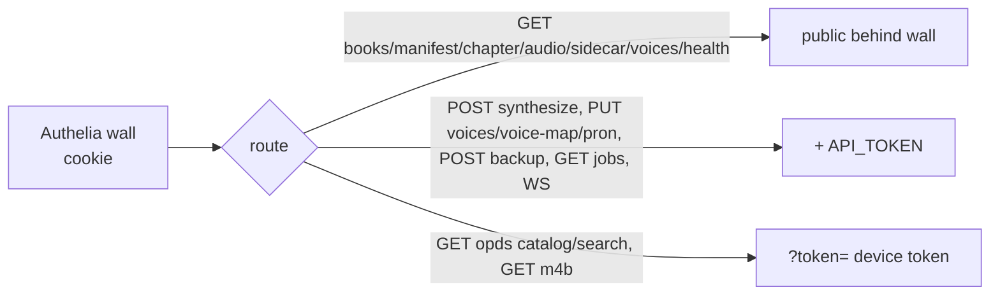

# API (frozen route table v1 — mirrors `openapi.yaml`)

Path changes are cross-worker breaking changes: `backend/app/main.py`, the
OpenReader fork wiring, and OPDS hardcode these. Auth: humans pass the
Authelia wall (cookie); `API_TOKEN` (fail-closed `secrets.compare_digest`)
additionally guards every mutating route, `/admin/*`, `/jobs`, and the WS
handshake. OPDS uses per-device `?token=` instead (readers can't log in).

| Method + path | Auth | Success | Notable errors |
|---------------|------|---------|----------------|
| `GET /api/v1/health` | none (deep probe) | `200` green | `503` names failing check (db, disk, scheduler, queue, model_ver, lncrawl) |
| `GET /api/v1/books` | wall | `200` Novel[] | `401` via wall unauthenticated |
| `GET /api/v1/books/{id}/manifest` | wall | `200` manifest (render_keys + URLs) | `401` |
| `GET /api/v1/books/{id}/chapters/{n}?format=json` | wall | `200` chapter json | `401` |
| `GET /api/v1/books/{id}/chapters/{n}/audio.opus` | wall | `200` full / `206` partial (`Accept-Ranges`, `ETag`=render_key hash, immutable, `If-Range`) | `401`; `501` until chapter rendered |
| `GET /api/v1/books/{id}/chapters/{n}/chapter.json` | wall | `200` sidecar v2 | `401` |
| `POST /api/v1/books/{id}/chapters/{n}/synthesize` | wall + `API_TOKEN` | `202` job id | `401` bad/missing token; `409` job already queued; `423` source quarantined |
| `GET /api/v1/voices` | wall | `200` Voice[] | `401` via wall |
| `PUT /api/v1/voices` | wall + `API_TOKEN` | `200` ok | `401` |
| `GET /api/v1/books/{id}/voice-map` | wall | `200` VoiceMap[] | `401` via wall |
| `PUT /api/v1/books/{id}/voice-map` | wall + `API_TOKEN` | `200` ok | `401` |
| `GET /api/v1/pron-dict` | wall | `200` PronEntry[] | `401` via wall |
| `PUT /api/v1/pron-dict` | wall + `API_TOKEN` | `200` ok | `401` |
| `GET /api/v1/opds/catalog.xml?token=` | device token | `200` OPDS 1.2 XML | `401` bad token |
| `GET /api/v1/opds/search?q=&token=` | device token | `200` OPDS XML | `401` bad token |
| `GET /api/v1/opds/books/{id}.m4b?token=` | device token | `200` audio/mp4 | `401`; cold chapters skipped |
| `POST /api/v1/admin/backup` | wall + `API_TOKEN` | `202` job id | `401`; full disk keeps last good ZIP + clear error |
| `GET /api/v1/jobs` | wall + `API_TOKEN` | `200` Job[] | `401` direct `:8000` without token |
| `GET /api/v1/ws?token=` | `API_TOKEN` handshake | `101` switched (control-plane, no PCM) | close `4401` missing/wrong token |

Status-code notes: `206` requires honoring single/open/suffix ranges and
`If-Range` (stale ETag -> full `200`). `202` means enqueued, follow via WS or
`/jobs`. `409`/`423` surface queue/source state instead of silent double-work.
Direct `:8000` from a sibling container without token -> `401` (never trusted).
