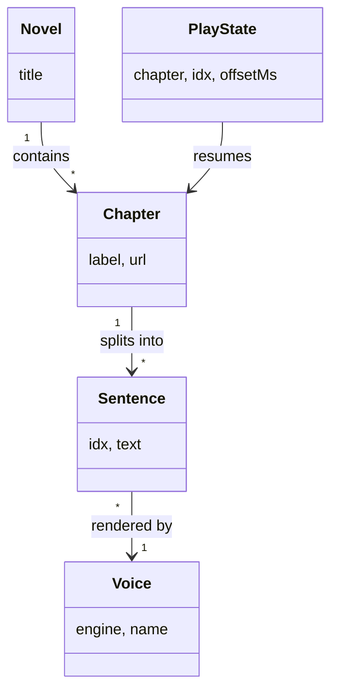
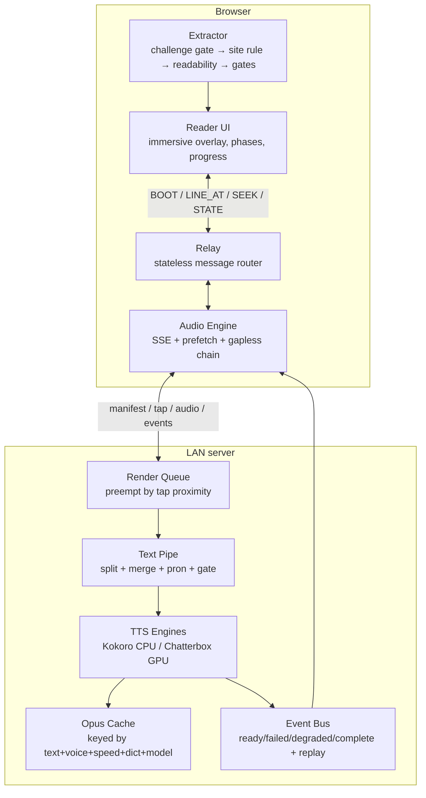
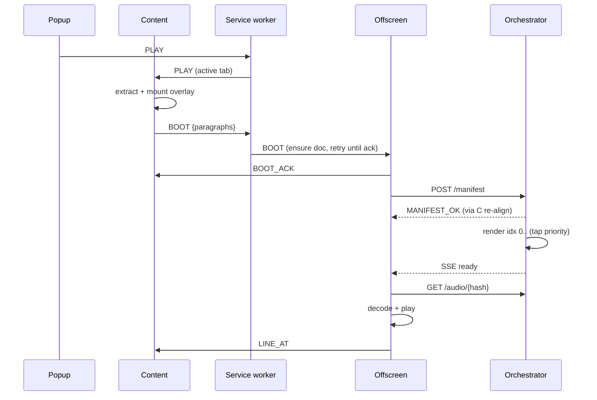
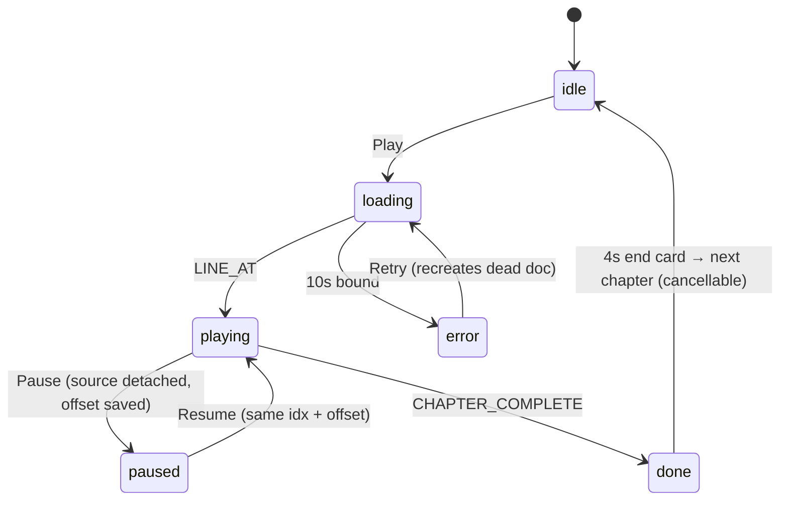

# InkTTS Architecture (MDA)

Three modeling levels: **CIM** (what the reader experiences), **PIM**
(platform-independent design), **PSM** (the concrete stack). Mermaid
diagrams render on GitHub.

## CIM — domain model

A reader opens a **Chapter** on its website. InkTTS extracts the chapter,
splits it into **Sentences** (the canonical unit: one overlay line = one
audio file), renders each with a **Voice**, and tracks **PlayState** so
pause/resume/kill all land on the exact sentence and offset.

## PIM — components (platform-independent)

Contracts:

- **Overlay lines == server sentences == audio files.** The orchestrator
  owns the split (`POST /manifest` returns the canonical list); the
  overlay re-aligns to it via `MANIFEST_OK`. Never the reverse.
- **Single resume triple.** `{docId, idx, offsetMs}` persisted on every
  line change; offscreen death is a normal, expected resume path.
- **Targeted messages.** Every message carries `target: sw|offscreen|content`;
  receivers ignore non-targets and never re-emit (no relay loops).
- **Provable delivery.** `BOOT` is retried until `BOOT_ACK` (doc recreated
  on the 2nd try); a 10 s bound names the silent half (`boot/*` vs server).

## PSM — concrete mapping

| PIM | PSM |
|---|---|
| Extractor | WXT content script, `@mozilla/readability`, block-level promo decompose, layered nav (`rel=` → hooks → scored scan → validated) |
| Reader UI | Preact in Shadow DOM, phase machine (`idle/loading/playing/paused/error/done`), pixel HP progress bar |
| Relay | MV3 service worker, stateless, `GET_STATE` mirror for the popup |
| Audio Engine | Offscreen document, Web Audio `AudioBufferSourceNode` chain, `Last-Event-ID` SSE resume + heartbeat watchdog |
| Render Queue | Python `heapq`, tap=0 / next=1 / prefetch=2+d, per-doc epochs, 1 h entry TTL |
| Text Pipe | `split_sentences` (300-char cap, 60-char stub merge), pron `=>` rules with cache-busting dict version |
| Opus Cache | Filesystem, key = `sha1(text\|engine_tag\|voice\|speed\|dict_ver\|model)`, 5 GB cap |
| Engines | CrispASR Vulkan GGUF: `kokoro-82m-q8` (+28 voice packs) and `chatterbox-v3` (+28 MIT ref voices), `/v1/voices` listing |

## Runtime sequences

### Play (cold)

### Pause / resume

Pause detaches the audio source *before* stopping it, because `stop()`
fires `onended` — without the guard every pause would auto-advance.

### Seek storm

Tap → `SEEK idx` → server `seek()` bumps the doc epoch (stale jobs
dropped, only the newest tap survives) → worker renders → `ready` →
fetch → play. Last tap always wins; overlapping audio is impossible
because the old source is detached before the new one starts.

## Failure semantics (never silent)

| Failure | Surface |
|---|---|
| Bot-check page | Overlay error card + Retry (re-runs extraction) |
| Image-only chapter | "Scanned pages — OCR out of scope" |
| Server unreachable | Named banner + Retry; 20 s fetch timeout |
| Player dead | 10 s bound → "Player did not answer" → Retry recreates the doc |
| Render gap | Bounded wait → named sentence error |
| GPU down | `degraded` badge, Kokoro fallback, playback continues |
| Settings change mid-play | Pause → re-manifest → resume at same sentence |

## Verification

- Extension: `pnpm typecheck`, 29 vitest, full Playwright E2E
  (`proof/browser_e2e_pw.py`: mount → seek → title/nav → theme →
  settings panel → playback auto-advance → challenge), zero page errors.
- Stack: pytest suite (queue, render, textpipe, SSE ring, `/voices`,
  pron, consent), live curl probes in `tts-stack/proof/`.
