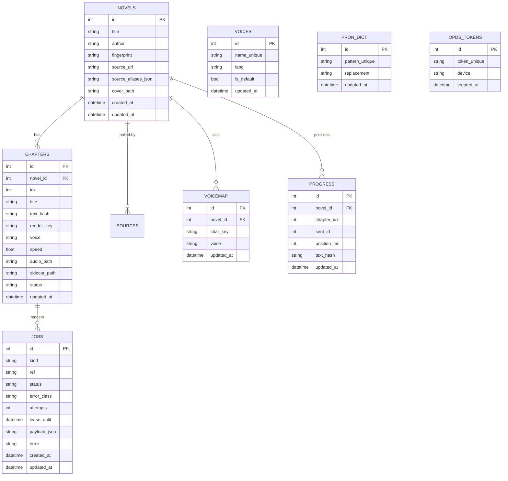

# Data model (frozen shapes — read `backend/app/models.py` before changing)

Why one SQLite file: the backup story is "copy one file + sidecars into a
ZIP". PG deferred until measured contention. WAL + `foreign_keys=ON` +
`busy_timeout=5000` (see `backend/app/db.py`).



## Per-table field rules

- **novels:** identity = `fingerprint` (title+author) plus `source_url` +
  `source_aliases` URL list; merge joins on fingerprint, surfaces conflicts in
  UI. `updated_at` UTC, LWW merge key.
- **chapters:** `text_hash` = sha256 of full source text (re-scrape equality =
  no re-synth). `status` in `ready|synthesizing|blocked|empty`. Two-tier gate:
  micro-chapters pass the min-length check. `audio_path`/`sidecar_path` are
  relpaths under `/data` (never absolute — NAS remounts must not break rows).
- **voices:** `name` unique (Kokoro id, e.g. `af_heart`); exactly one
  `is_default`. Merge: server LWW on `updated_at`.
- **voice_map:** merged **per-character-key** (`char_key`), not whole-row, so
  two devices casting different characters both survive.
- **pron_dict:** `pattern` unique; regex pre-replace with `\b` + longest-first
  match + preview hit-count. Merge is record-level union.
- **jobs:** queue truth, no broker. `kind` in
  `synth|crawl|refetch|backup|repair`; `ref` e.g. `novel:3:ch:12`; `status` in
  `queued|running|done|failed|blocked`; `error_class` in
  `blocked|empty|parse|transient` decides retry. Atomic claim+lease, coalesce,
  `max_instances=1`, misfire 1800s, per-host cap `JOBS_MAX_PER_HOST=4`.
- **progress:** sentence granularity (`chapter_idx`, `sent_id`,
  `position_ms`). Server-time LWW + 5s flap; push ~2s + pause/background; pull
  on focus/playback start. `text_hash` mismatch -> clamp + orphan flag (position
  kept, flagged stale — never silently applied to new text).
- **opds_tokens:** long random per-device tokens; only exemption path past the
  wall (readers can't log in).

## Sidecar v2 JSON schema (`{idx}.{hash8}.json`)

```json
{
  "schema": 2,
  "novel_id": 3,
  "chapter_idx": 12,
  "text_hash": "sha256-of-source-text",
  "render_key": "af_heart@1.0x:kokoro-82M-onnx-v1",
  "sentences": [
    {"sent_id": 0, "text": "The lanterns swayed.", "t_start": 0.0, "t_end": 1.42},
    {"sent_id": 1, "text": "Mara quickened her pace.", "t_start": 1.42, "t_end": 3.05}
  ],
  "dur_s": 95.2
}
```

Rules: `sent_id` **positional** per chapter version (NOT stable across
re-scrapes — player must re-resolve after repair). Timings measured from
**shipped Opus bytes**, never pre-encode estimates (Opus padding shifts every
sentence). Schema versioned (`SIDECAR_SCHEMA_VER=2`); old versions trigger
lazy re-render, never a crash.

## render_key pinning

`render_key = voice + "@" + speed + "x:" + MODEL_VER`
(`MODEL_VER = "kokoro-82M-onnx-v1"`, surfaced in `/health`). Pinned **per
chapter row**: a global voice/speed/model change touches zero existing rows.
New chapters use the new key; old chapters re-render only via the explicit
re-synth button. Why: an unpinned change would storm the whole library with
synth jobs.

## Gapless invariant

`next.t_start == prev.t_end` for every adjacent sentence pair, asserted after
every render (`backend/tests/test_render.py`). The `ended` event (not manifest
sum) drives chapter advance — Opus end-padding means `dur_s` overshoots the
last `t_end`.

## Audio path sharding

`audio/{novel_id}/{idx // 1000}/{idx}.{hash8}.opus`, `hash8` = first 8 of
`text_hash`. Shard keeps directories small at 1000s of chapters; hash-in-URL
makes bytes immutable (`ETag = render_key hash`, `Cache-Control: immutable`).
Same sharding for sidecars (`.json`). Relpaths in DB, absolute resolution via
`DATA_DIR` at serve time.

## WAL / NAS rules

- `/data/db` (SQLite + WAL + scheduler state) lives on **host-local disk
  ONLY** — WAL corrupts on NFS locks (`docker-compose.yml` comment).
- Audio, epubs, backups **may** live on NAS (plain files, no locking).
- `DATABASE_URL=sqlite:////data/db/inkcast.db` default; Alembic upgrade head
  must be idempotent (empty + re-run = no-op).
