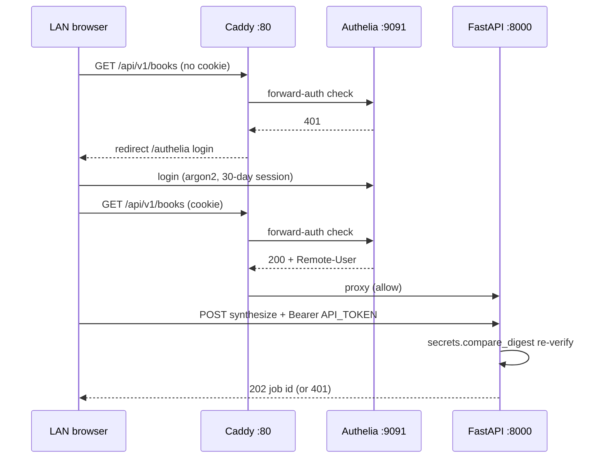

# Auth wall (Caddy + Authelia forward-auth)

Why: zero auth code in the app. Authelia + Caddy is premade, audited, and
single-user-sufficient. The app trusts the wall **plus** a per-request
`API_TOKEN` re-verify, never raw LAN. Full operator notes:
`docs/ops/auth-wall.md`.

## OPDS token exemption

Readers (KOReader) can't log in, so `/api/v1/opds*` bypasses forward-auth in
the Caddyfile and carries a long per-device `?token=` instead (minted server
side, stored in `opds_tokens`). Humans always log in; without this exemption
the locked-OPDS claim is dead. Bad token -> 401.

## WS 4401

`/api/v1/ws` is control-plane only (no PCM). Handshake requires
`?token=<API_TOKEN>`; missing/wrong token -> close `4401`. Re-auth on every
(re)connect — no cookie trust, no long-lived socket bypass.

## Secure-cookie LAN note

Plain-`http://LAN-IP` install: `secure: false`, cookie `domain: ""`
(`ops/authelia-config.yml`). Browsers drop `Secure` cookies over plain http,
so `secure: true` here locks you out silently. Flip to `secure: true` + real
cookie domain only when you add a hostname and a `:443` listener. Related
fixes already in config: `:443` dead listener removed, Tailscale `domain:""`
mismatch fixed, `regulation` brute-force block (3/120s -> 300s ban),
filesystem notifier (no SMTP on LAN).
