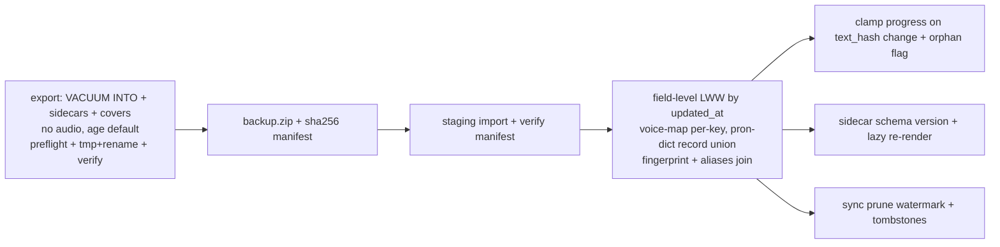

# Backup ZIP + merge (no accounts, no server)

- Quiesce export during synth (sweep zombie RUNNING + half sidecars).
- Double-import idempotent (content-hash dedupe); forward-migration fixture
  in CI; restore onto older refuses with message; clock-skew warns (never blocks).
- Passphrase rotation affects new backups only.
- Full-disk export never kills last good backup.
