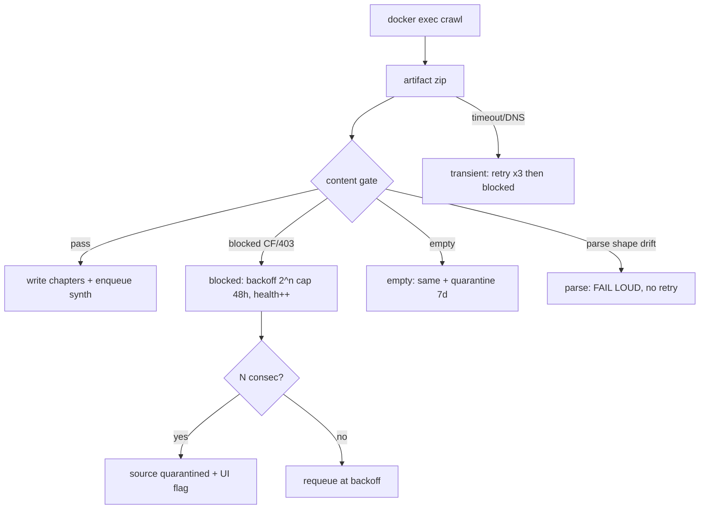
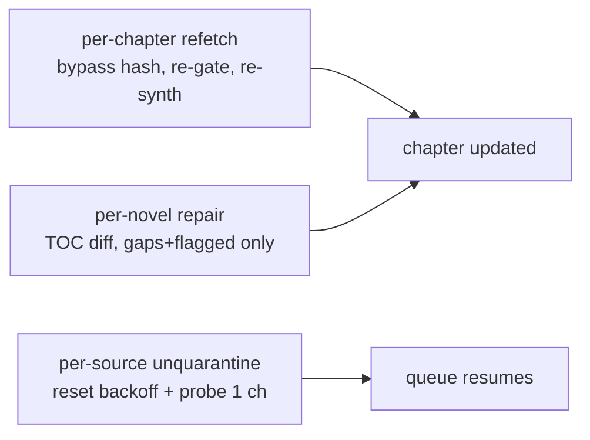

# Crawl error lifecycle + refetch (locked)

Principle: **failed content never touches chapters.** Validate-then-commit in
one transaction: content gate runs on lncrawl artifact BEFORE any row write.
Failure = `jobs` row with error class, never a chapter row.

## Refetch (explicit buttons)

- Per-job artifact dirs (no zip races); parse zips only, never stdout.
- Exec timeout -> SIGKILL tied to job lease; boot sweep of stale tmp.
- Serialize challenge-solves (max_instances=1/origin) or per-job profiles.
