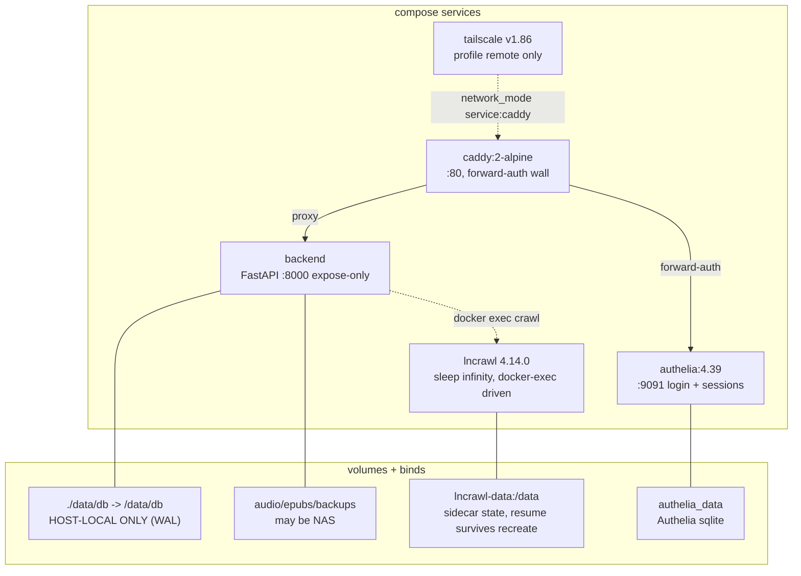

# Deployment (compose services, volumes, boot order)

Single box on the LAN. Four always-on services; Tailscale optional via
`--profile remote` (no ports opened, needs a free account + `TS_AUTHKEY`).



## Volumes

| Mount | Backend path | Rule |
|-------|--------------|------|
| `./data/db` | `/data/db` | host-local disk ONLY (WAL breaks on NAS locks) |
| `./data/audio`, `./data/epubs`, `./data/backups` | `/data/...` | may live on NAS (plain files) |
| `./backend/models` | `/app/models` | model weights (Kokoro ONNX) |
| `./frontend/dist` | `/app/frontend/dist:ro` | static PWA served by FastAPI |
| `lncrawl-data` | sidecar `/data` | upstream `LNCRAWL_DATA_PATH=/data`; backend ingests read-only + per-job dirs |
| `/var/run/docker.sock:ro` | socket | backend drives sidecar via `docker exec`; blast radius = host-root equivalent, accepted on single-user LAN box behind the wall |
| `authelia_data` | `/config/db` | Authelia sqlite + filesystem notifier |

## Profiles

- Default: `caddy + authelia + backend + lncrawl` (LAN only).
- Remote: `docker compose --profile remote up -d` adds `tailscale`, which
  serves Caddy's `:80` over the tailnet (`ops/ts-serve.json`); cookie
  `domain: ""` keeps the wall working on both LAN-IP and tailnet.

## Boot order + first run

`depends_on`: caddy waits for backend + authelia; backend waits for lncrawl
started. Backend healthcheck polls `/api/v1/health` (30s interval, 60s start
period). First run:

```bash
cp .env.example .env   # fill API_TOKEN + 3 AUTHELIA_* secrets
# hash password -> ops/users_database.yml (argon2, one user is enough)
docker run --rm authelia/authelia:4.39 authelia crypto hash generate argon2 --password 'YOUR_PASSWORD'
docker compose config > /tmp/inkcast-config.yml && echo CONFIG_OK
docker compose up -d --build
docker compose ps
curl -s -o /dev/null -w '%{http_code}\n' http://127.0.0.1/api/v1/books  # 401 = wall up
```

Then log in at `http://<host-lan-ip>/authelia`, re-check the API (200), mint
the OPDS token — full sequence in `ops/BOOT_CHECK.md` steps 2-6.
