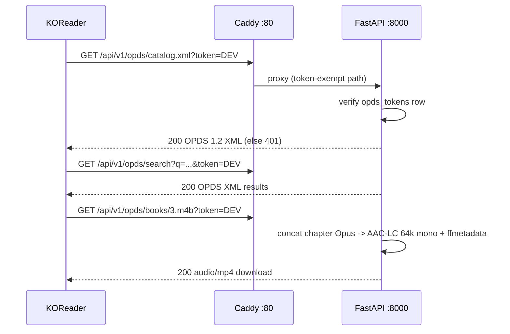

# OPDS catalog + M4B export

Why OPDS 1.2: KOReader speaks it natively — one token URL gives the e-reader
the whole library with no login. Why M4B: a single AAC audiobook file with
chapters for listeners who don't want the PWA.

M4B chapter math: per-chapter durations from sidecars, ffmetadata `START/END`
in ms. Encoder priming adds ~43ms of leading silence, so chapters 2..N shift
+43ms to stay contiguous (`END[i]==START[i+1]`, locked by
`test_m4b_chapter_math`); chapter[0].START clamps to media start (0) — known
muxer behavior, not a bug. Live round-trip covered by
`test_m4b_live_encode_roundtrip` (skipped when ffmpeg absent).

Cold chapters (no audio yet) are skipped from the M4B with the gap noted;
enqueue synth first via `POST .../synthesize` if the book is incomplete.
