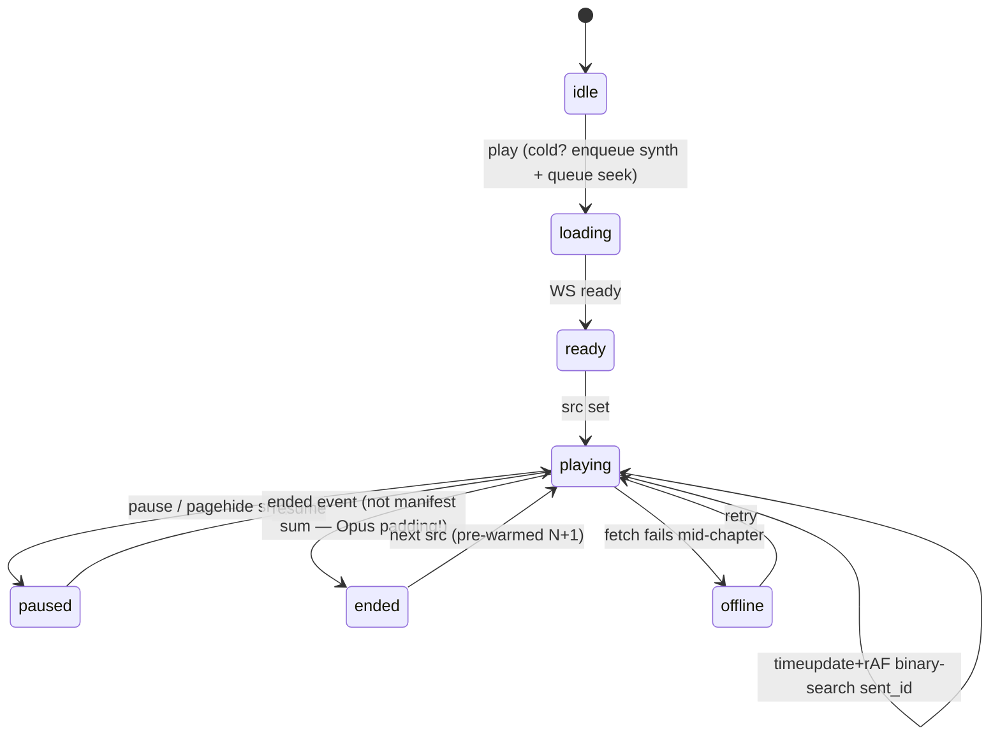

# Playback + progress (cold/short/offline/multi-tab closed)

Warm-cache path is trivial; this doc locks the holes.

Rules:
- `sent_id` spans, highlight <200ms, tap-to-seek, slider, client-side speed
  (manifest rate recorded).
- Cold-synth seek queues (never set on empty `src`); seek-to-100% single-advance.
- Chapters <60s still prefetch (60s-before-end trigger has boundary rule).
- `pagehide` + `visibilitychange` snapshot (mobile `beforeunload` never fires).
- Two-tab leader: second tab read-only for position (no 2s-LWW ping-pong).
- Sleep timer cancels in-flight prefetch; quota-full -> stream-only + message.
- Orphan audio/manifest has repair direction; backup-version gate;
  import locks position writes; UTC everywhere.
