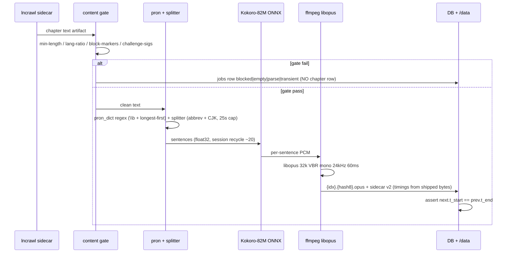

# Render pipeline (crawl -> gate -> synth -> Opus -> manifest)

Why this pipeline shape: audio must be immutable and highlight-exact or the
read-along illusion breaks. Timings are measured from shipped Opus bytes
because Opus padding shifts every sentence vs pre-encode estimates.
Full-chapter re-synth (no diff) because positional `sent_id` + diff-merge
caused more corruption than the CPU it saved.

Two-tier gate: micro-chapters pass min-length. TL/A-N notes go to the notes
field, never synth. ALL-CAPS folds through an acronym safelist.

## Re-synth rules

- Same text re-scraped (`text_hash` equal) -> no re-synth, reuse bytes.
- Changed text -> **full** chapter re-synth + new `hash8` URL (old bytes
  orphaned, never mutated).
- Voice/speed/model change -> old chapters untouched (`render_key` pinned);
  explicit per-chapter re-synth button only. No library storm.
- Orphan audio/manifest (one side missing) has a fixed repair direction:
  re-render from text; never serve half a pair.

## Storm guards

- Jobs table is the queue (atomic claim+lease, coalesce, `max_instances=1`,
  misfire 1800s, boot stagger, per-host cap `JOBS_MAX_PER_HOST=4`).
- `AUTO_SYNTHESIZE_DEFAULT=0`: new chapters queue synth only when enabled.
- `SYNTH_ENABLED=0` kills synth globally (crawl-only mode).
- Cold-synth seek queues on the player; never set `src` on empty audio.
