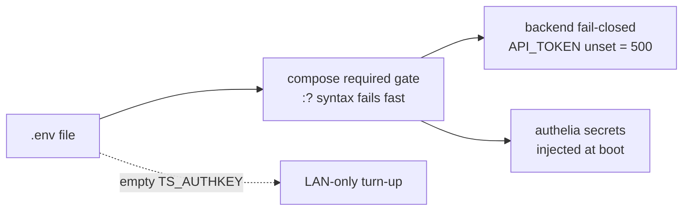

# CONFIG (every env var: required / default / effect)

Copy `.env.example` -> `.env`. `API_TOKEN` + the three `AUTHELIA_*` secrets
are REQUIRED — the backend fail-closes (500 on guarded routes) when
`API_TOKEN` is unset. Values below cross-checked against
`docker-compose.yml` and `backend/app/{db,main,tts,jobs,scheduler,scraper/client}.py`.

| Var | Required | Default | Effect |
|-----|----------|---------|--------|
| `API_TOKEN` | **yes** | — (compose `:?` fails fast) | Bearer token on all mutating routes, `/admin/*`, `/jobs`, WS `?token=` handshake (`secrets.compare_digest`); unset -> fail-closed 500 |
| `AUTHELIA_JWT_SECRET` | **yes** | — | password-reset JWT signing (identity_validation) |
| `AUTHELIA_SESSION_SECRET` | **yes** | — | `inkcast_session` cookie signing (30-day sessions) |
| `AUTHELIA_STORAGE_ENCRYPTION_KEY` | **yes** | — | Authelia sqlite encryption at rest |
| `TS_AUTHKEY` | no | empty = LAN-only | Tailscale login for `--profile remote`; empty leaves the tailnet off |
| `DATABASE_URL` | no | `sqlite:////data/db/inkcast.db` | SQLAlchemy URL; Alembic `env.py` falls back to the same default |
| `DATA_DIR` | no | `/data` | root for db/audio/epubs/backups resolution + disk-free check in `/health` |
| `LNCRAWL_CONTAINER` | no | `inkcast-lncrawl` | container name backend `docker exec`s for crawls |
| `LNCRAWL_DATA_PATH` | no | `/data` | sidecar's own data dir (4.14.0 `ENV`) — volume must land here, not a bare guess |
| `LNCRAWL_MOUNT` | no | `/data/lncrawl` | where the backend looks for sidecar output when ingesting |
| `KOKORO_MODEL_PATH` | no | `/data/models/kokoro-82M.onnx` | ONNX weights; unset/empty -> stub tone (RTF bench + ABX need the real file) |
| `OMP_NUM_THREADS` | no | `2` | onnxruntime CPU threads (also set as compose `ENV`) |
| `TTS_ENGINE` | no | `kokoro` | engine selector (only `kokoro` implemented; no Chatterbox/cloning) |
| `TTS_OPUS_BITRATE` | no | `32k` | ffmpeg `libopus -b:a` for chapter audio |
| `AUDIO_CACHE_MB` | no | `500` | audio cache budget |
| `PREFETCH_AHEAD` | no | `1` | chapters pre-warmed ahead of the listener (N+1) |
| `SYNTH_ENABLED` | no | `1` | `0` = crawl-only mode, synth queue paused |
| `AUTO_SYNTHESIZE_DEFAULT` | no | `0` | `1` = new chapters auto-queue synth jobs |
| `JOBS_MAX_PER_HOST` | no | `4` | max concurrent `running` jobs per host |
| `SCHEDULER_STATE_PATH` | no | `/data/db/scheduler_state.json` | crawl schedule persistence (survives recreate) |
| `SCHEDULER_HEARTBEAT_PATH` | no | `/data/db/scheduler.heartbeat` | heartbeat file `/health` checks for staleness |
| `PYTHONUNBUFFERED` | no | `1` (compose) | unbuffered logs for `docker logs` |

Compose-only (`ENV`, not read from shell): `OMP_NUM_THREADS=2` is also baked
into the backend image (`backend/Dockerfile`). `PYTHONUNBUFFERED=1` likewise.
