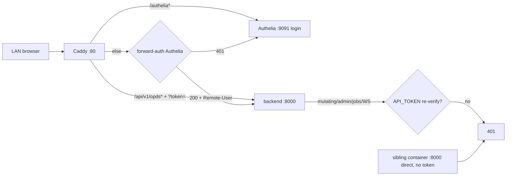

# Auth wall (Task 4)

Zero auth code in the app for humans: **Authelia + Caddy** is the wall
(premade, audited, single-user-sufficient). The app trusts the wall plus a
per-request `API_TOKEN` re-verify, and never trusts raw LAN.

OPDS readers (KOReader etc.) can't log in, so they get a **per-device token
URL exemption** (`backend/app/tokens.py` + `opds_auth.py`, wired in Wave 2 /
Task 8). Humans always log in; without the exemption the locked-OPDS claim
would be dead.

## Wall flow

Backend `expose: 8000` only — LAN clients go through Caddy, never direct.
Direct `:8000` without a Bearer token is 401 (not trusted).

## Profiles & fixed gotchas

- **Secure-cookie http-LAN-IP profile:** `secure: false`, `domain: ""` in
  `ops/authelia-config.yml`. Browsers drop `Secure` cookies over plain http,
  so `secure: true` on a LAN-IP install locks you out silently. Only flip to
  `secure: true` + real cookie domain when you have a hostname + `:443`.
- **30-day sessions:** `expiration: 720h`, `remember_me: 720h`,
  `inactivity: 24h`.
- **Regulation (brute-force) block:** 3 retries / 120s window -> 300s ban.
  Single user, no legit retry storms.
- **Tailscale domain fix:** cookie `domain: ""` + `authelia_url: ""`
  (no hostname baked in), so the same wall works over LAN-IP and over the
  tailnet (`ops/ts-serve.json` proxies tailnet `:443` -> Caddy `:80`).
- **`:443` removed:** no dead TLS listener on a plain-LAN install without a
  domain/cert. Re-add only with a real hostname (then flip the cookie
  profile above).
- **Filesystem notifier:** password-reset mails land in
  `/config/db/notification.txt` — no SMTP on LAN.
- **Authelia sqlite** lives on the `authelia_data` volume; include it in the
  backup story (Task 6).

## First-run bootstrap

1. Copy `.env.example` -> `.env`, fill `API_TOKEN` + the three
   `AUTHELIA_*` secrets (all required — backend fail-closes 500 if
   `API_TOKEN` is unset).
2. Generate the user hash and paste it into `ops/users_database.yml`:
   `docker run --rm authelia/authelia:4.39 authelia crypto hash generate argon2 --password 'YOUR_PASSWORD'`
   One user is enough. Restart authelia after editing.
3. `docker compose up -d --build`, then follow `ops/BOOT_CHECK.md`.
4. Mint a per-device OPDS token (Wave 2 wires the check; mint via python):
   `docker compose exec backend python -c "from app.tokens import ..."`
   (exact command in `ops/BOOT_CHECK.md`). Token is shown once.

## WS re-auth rule

`/api/v1/ws` takes `?token=<API_TOKEN>` at handshake; missing/wrong token
-> close `4401`. Re-auth on every (re)connect — no cookie trust, no
long-lived socket bypass.
